```mermaid
sequenceDiagram
    autonumber

    participant User
    participant UI
    participant AgentAPI as Agent API Server
    participant Queue as BullMQ / Redis Queue
    participant Orchestrator as Run Orchestrator (BullMQ Worker)
    participant Memory as Memory Service
    participant Retrieval as Retrieval API
    participant LLM
    participant Tool as Tool Runtime / Tool Router
    participant Distiller as Memory Distiller (memory-extractor)

    %% --- User sends a message (non-blocking) ---
    User ->> UI: Type prompt ("do X")
    UI ->> AgentAPI: POST /assignments/{id}/messages (user message)
    AgentAPI ->> AgentAPI: Persist user message (append-only)
    AgentAPI ->> AgentAPI: Create run (status=queued, trigger_message_id)
    AgentAPI ->> Queue: Enqueue run.execute(run_id)
    AgentAPI -->> UI: 202 Accepted (run_id, stream_url)

    %% --- UI subscribes to streaming updates ---
    UI ->> AgentAPI: GET /runs/{run_id}/stream (SSE)
    AgentAPI -->> UI: SSE connected
    AgentAPI -->> UI: SSE run.status=queued

    %% --- Cancellation (can happen anytime) ---
    par User cancels (optional)
        User ->> UI: Cancel
        UI ->> AgentAPI: POST /runs/{run_id}/cancel
        AgentAPI ->> AgentAPI: Mark run cancel_requested=true
        AgentAPI -->> UI: 202 Accepted (cancel requested)
        AgentAPI -->> UI: SSE run.cancel_requested
    and Orchestrator continues until it checks cancellation
        Note over Orchestrator: Orchestrator checks cancel_requested between steps
    end

    %% --- Orchestrator starts the run ---
    Queue ->> Orchestrator: Dequeue run.execute(run_id)
    Orchestrator ->> Orchestrator: Acquire lock (e.g., per-assignment or per-run)
    Orchestrator ->> Orchestrator: If cancel_requested then cancel immediately
    alt cancel_requested before start
        Orchestrator ->> Orchestrator: Update run status=cancelled
        Orchestrator -->> AgentAPI: Emit run.status=cancelled
        AgentAPI -->> UI: SSE run.status=cancelled
        Orchestrator ->> Orchestrator: Release lock
    else run proceeds
        Orchestrator ->> Orchestrator: Update run status=running
        Orchestrator -->> AgentAPI: Emit run.status=running
        AgentAPI -->> UI: SSE run.status=running

        %% --- Load context ---
        Orchestrator ->> Orchestrator: Load assignment messages from DB

        %% --- Retrieval + Memory (advisory context) ---
        Orchestrator ->> Memory: POST /v1/memories/search (query=last user msg)
        Memory -->> Orchestrator: Top memories (ids, content, confidence)
        Orchestrator ->> Retrieval: POST /v1/retrieval/query (query=last user msg)
        Retrieval -->> Orchestrator: Top hits (chunk ids, sources, scores)
        Orchestrator ->> Orchestrator: Persist run snapshot (memories_used + retrieval_hits)
        Orchestrator -->> AgentAPI: Emit run.snapshot (counts, ids)
        AgentAPI -->> UI: SSE run.snapshot

        %% --- Planner phase (LLM call #1) ---
        Orchestrator ->> Orchestrator: Check cancel_requested
        alt cancel_requested during pre-plan
            Orchestrator ->> Orchestrator: Update run status=cancelled
            Orchestrator -->> AgentAPI: Emit run.status=cancelled
            AgentAPI -->> UI: SSE run.status=cancelled
            Orchestrator ->> Orchestrator: Release lock
        else continue
            Orchestrator ->> LLM: Plan (messages + memories + retrieval hits)
            LLM -->> Orchestrator: Structured plan (steps, tool intents)
            Orchestrator ->> Orchestrator: Persist plan (run_step #1)
            Orchestrator -->> AgentAPI: Emit plan.created
            AgentAPI -->> UI: SSE plan.created
        end

        %% --- Execution loop (LLM call #2, iterative) ---
        loop Until final OR max_steps OR cancelled
            Orchestrator ->> Orchestrator: Check cancel_requested
            alt cancel_requested mid-run
                Orchestrator ->> Orchestrator: Update run status=cancelled
                Orchestrator -->> AgentAPI: Emit run.status=cancelled
                AgentAPI -->> UI: SSE run.status=cancelled
            else continue
                Orchestrator ->> LLM: Execute next step (plan + observations)
                alt Tool required
                    LLM -->> Orchestrator: Tool call (name + args)
                    Orchestrator -->> AgentAPI: Emit tool.call
                    AgentAPI -->> UI: SSE tool.call

                    Orchestrator ->> Tool: Execute tool (policy checked)
                    Tool -->> Orchestrator: Tool output (stdout/stderr/structured)
                    Orchestrator ->> Orchestrator: Persist tool_call + tool_result
                    Orchestrator -->> AgentAPI: Emit tool.result (summary)
                    AgentAPI -->> UI: SSE tool.result
                    Orchestrator ->> Orchestrator: Append observation to context
                else Final answer
                    LLM -->> Orchestrator: Final response text
                    Orchestrator ->> Orchestrator: Persist assistant message (with provenance)
                    Orchestrator -->> AgentAPI: Emit message.created (assistant)
                    AgentAPI -->> UI: SSE message.created
                    Orchestrator ->> Orchestrator: Update run status=completed
                    Orchestrator -->> AgentAPI: Emit run.status=completed
                    AgentAPI -->> UI: SSE run.status=completed
                end
            end
        end

        %% --- Post-run: Distill memories (async, only if completed) ---
        alt run completed
            Orchestrator ->> Distiller: POST /v1/distill (transcript/run metadata)
            Distiller -->> Orchestrator: 202 Accepted (job queued)
            Orchestrator -->> AgentAPI: Emit distill.triggered
            AgentAPI -->> UI: SSE distill.triggered
        else run cancelled or failed
            Note over Orchestrator: Distillation skipped or handled differently (policy choice)
        end

        Orchestrator ->> Orchestrator: Release lock
    end
```

# Agent System Architecture (V2 - Run Orchestrator)

## Overview
This architecture separates the **Control Plane** (REST API, State Management) from the **Data Plane** (LLM Execution, Tool Runtime). This "Run Orchestrator" pattern ensures the system is scalable, observable, and resilient to failures, enabling long-running agent loops without blocking the user interface.

For how the LLM-facing prompt text itself is stored, versioned and inspected, see
[PROMPT_MANAGEMENT.md](PROMPT_MANAGEMENT.md) and section 6 below.

## 1. System Architecture

The system is composed of Kubernetes-native components communicating via **Queues** (Redis) and **APIs**.

```mermaid
graph TD
    User[User Client / UI] -->|POST Message & Run| API[Agent API Gateway]
    User -->|SSE Stream| API

    subgraph "Control Plane"
        API -->|Enqueue Run| Queue[Run Queue (Redis)]
        API -->|Read/Write| DB[(Postgres)]
    end

    subgraph "Data Plane"
        Orchestrator[Run Orchestrator] -->|Poll| Queue
        Orchestrator -->|Stream Events| PubSub[Redis PubSub]
        PubSub --> API
        
        Orchestrator -->|Inference| LLM[LLM Service (Ollama/vLLM)]
        Orchestrator -->|Execute| ToolRouter[Tool Router]
        Orchestrator -->|Context| Memory[Memory Service]
    end

    subgraph "Tooling Layer"
        ToolRouter -->|Fetch| Web[Web Tools]
        ToolRouter -->|Git/Code| Sandbox[Code Sandbox]
        ToolRouter -->|Query| VectorDB
    end
```

## 2. Component Design

### A. Agent API Gateway (Control Plane)
**Responsibility**: 
- Authenticated CRUD for Assignments, Messages, Runs, and Tools.
- Starts runs and streams progress via Server-Sent Events (SSE).
- Enforces multi-tenancy (Keycloak attributes).
- **Non-blocking**: `POST /messages` returns immediately (202 Accepted) with a `stream_url`.

**Key Endpoints**:
- `POST /v1/assignments/{id}/messages`: Accept user input, queue run.
- `GET /v1/assignments/{assignment_id}/runs/{id}/stream`: SSE endpoint for real-time tokens and tool events.
- `POST /v1/assignments/{assignment_id}/runs/{id}/cancel`: Stop an active run.

### B. Run Orchestrator (Data Plane)
**Responsibility**:
- The "Brain" of the operation. Consumes jobs from the Run Queue.
- executes the core ReAct / Planner loop:
  `INITIALIZE → RETRIEVE → PLAN → ACT (Tool) → OBSERVE → ... → FINALIZE`
- **Idempotency**: Guarantees that a run can be paused/resumed (in future).
- **Persistence**: Writes every `RunStep` and `ToolCall` to Postgres for replayability.

**Implementation**:
- Node.js Worker (BullMQ processor).
- Stateless (fetches context from DB at start of job).

### C. Tool Router (Safety Layer)
**Responsibility**:
- A centralized "Proxy" for all side-effects. 
- The Orchestrator *never* calls external APIs or executes code directly. It asks the Tool Router.
- Enforces strict security policies (e.g., "Only allow GET requests to these domains", "Code execution timout 5s").

**Security**:
- **Istio Policy**: Only the `tool-router` service has egress access to sensitive external services.
- **Secrets**: API keys are injected into the Tool Router, not the Orchestrator/LLM.

## 3. Data Model

### The "Run" Concept
A **Run** represents a single execution cycle triggered by a user message or an automated event.

- **Assignment**: The persistent conversation context.
- **Run**: A specific attempt to answer a request. Contains many **Steps**.
- **Run Step**: An atomic action (Reasoning Trace or Tool Call).

**Schema Overview**:
- `assignments`: Context holder.
- `runs`: Status (`queued`, `running`, `completed`), timestamps, snapshots, plus the
  resolved `model_name` and the `promptset_version` / `promptset_hash` that produced the
  run. The promptset pair is what makes an eval score attributable to specific prompt text
  rather than only to a container image tag.
- `run_steps`: The detailed audit log of the agent's thought process. Step index 0 holds
  the fully rendered executor system prompt together with its `prompt_id` and
  `prompt_hash`, so a single historical run can be reconstructed exactly.
- `tool_calls`: Structured input/output for tools, distinct from text execution.

## 4. Execution Flow (Async Chat)

1.  **User Sends Message**:
    - Client POSTs to `/v1/assignments/:id/messages`.
    - API saves the `User Message` to DB.
    - API creates a `Run` record (status: `queued`).
    - API enqueues the Run ID to Redis.
    - API returns `202 Accepted` + `stream_url`.

2.  **Orchestrator Pickup**:
    - Worker grabs the job.
    - Fetches conversation history and relevant memories (`INITIALIZE`).
    - Emits `run.status = running` event.

3.  **Planning**:
    - Sends history plus retrieved memories to the LLM and parses a JSON plan
      (`planner.system`).
    - Emits `plan.created`.

4.  **Branch on plan size**: the loop is not always entered.
    - **Zero-step plan** (`plan.steps.length === 0`): the executor is skipped entirely and
      the answer comes from a single LLM call using `direct.system`. Greetings,
      acknowledgements and anything already answerable from injected context take this
      path, which makes it the most common path for conversational turns.
    - **Non-empty plan**: the full executor loop runs, below.

5.  **Agent Loop** (non-empty plans only):
    - **Plan/Think**: Sends history to LLM. Streaming tokens are published to Redis PubSub -> API -> User Client.
    - **Decide Tool**: LLM requests `weather_api`.
    - **Execute Tool**: Orchestrator persists `ToolCall` and invokes `ToolRouter`.
    - **Observe**: ToolRouter returns JSON. Orchestrator appends result to context. Failed
      tool output is wrapped in `<untrusted_tool_output>` tags and state-changing tools are
      gated once the context holds untrusted content.
    - **Repeat**: Loop continues until LLM provides a final text answer.

6.  **Completion**:
    - Orchestrator saves `Assistant Message` to DB.
    - Updates `Run` status to `completed`, stamping `model_name`, `promptset_version` and
      `promptset_hash`.
    - Triggers **Memory Distiller** (async) to learn from the interaction.

## 5. Deployment & Build Order

**Namespace**: `bouc-agent`

1.  **Phase 1: Foundation**
    - `Postgres` (Assignments/Runs schema).
    - `Redis` (Queue/PubSub).
    - `Agent API` (CRUD + Mock Run Enqueue).

2.  **Phase 2: The Orchestrator**
    - `Run Orchestrator` Deployment (BullMQ Worker).
    - Basic Loop: History + LLM (No tools).
    - SSE Streaming implementation in API.

3.  **Phase 3: Tooling**
    - `Tool Router` Deployment.
    - Implement `http.fetch` and `web.search`.
    - Connect Orchestrator to Tool Router.

4.  **Phase 4: Advanced Capabilities**
    - Connect `Memory Service` (RAG).
    - Implement `Memory Distiller` for post-run learning.
    - Add `Code Sandbox` tool.

## 6. Prompt Architecture

Full detail, including the inventory, the versioning scheme and the list of known
divergences, is in [PROMPT_MANAGEMENT.md](PROMPT_MANAGEMENT.md). The architectural points:

**Prompt text is not in the code.** All 31 units for this service live in `prompts/*.md`,
one file per unit with frontmatter carrying `id`, `version`, `stage`, `role`, declared
`includes` and declared `variables`. `npm run prompts:build` compiles them into the
committed `src/prompts/generated.ts`, which is also the promptset lock: it holds every
per-unit hash plus the set hash.

The builders in `planner.ts`, `executor.ts` and `runOrchestrator.ts` no longer contain any
prompt text. They do variable derivation only: which optional blocks apply and how they are
joined.

**Prompts by stage.**

| Stage | Prompt | Notes |
|---|---|---|
| Planner | `planner.system` | plus `planner.memory-context` and `planner.tool-list` when applicable, and `planner.nudge` as a trailing user turn |
| Planner | `planner.retry` | only on a JSON parse failure |
| Re-planner | `replanner.system`, `replanner.input` | only when `enable_replanning` is set |
| Executor | `executor.system` | composed from four fragments by include |
| Executor | `executor.summarize-nudge` | forced summarization when the model returns neither content nor tool calls |
| Direct | `direct.system` | the zero-step path from step 4 above |
| Chat | `chat.system` | the `/v1/chats` surface; assembled by `services/chat/chatPrompt.ts`, one LLM call, no planner |
| Compaction | `compaction.system`, `compaction.summary-wrapper` | long-horizon context reclamation |

**Composition.** `executor.system` pulls in `security-untrusted`, `tool-error-policy`,
`assumptions` and `formatting` at build time. The remaining fragments (no-parrot variants,
completion-instruction variants, tool-list blocks, section headers) are selected by the
builders at runtime. `GET /v1/prompts/{id}` returns `included_by` for a fragment, which
answers "what does editing this change" before you edit it.

**Determinism.** The executor and direct builders take an injected `now` rather than
reading the clock internally. Without that, no two renders are equal, which would make both
`/v1/prompts/{id}/rendered` and the committed golden renders impossible.

**`/no_think` is in five prompts**, not just the planner as previously documented:
`planner.system`, `replanner.system`, `executor.system`, `direct.system` and
`compaction.system`. (`planner.retry` deliberately omits it, being a minimal
last-resort prompt.) It is a Qwen3-specific text directive that
non-Qwen3 models ignore, and `think: false` is passed at the Ollama API level alongside it.
Normalising both into one reasoning-effort parameter on the LLM client is open work.

**Inspection.** `/v1/assignments/prompts`, `/v1/assignments/prompts/{id}`,
`/v1/assignments/prompts/{id}/rendered` and `/v1/assignments/promptset`, all read-only and
gated to any bouc.io staff role (`BOUC_ROLES`). Not `ADMIN_PORTAL_ROLES`, which also
includes customer org administrators.

They nest under `/v1/assignments` so that the already-registered Istio and oauth2-proxy
prefix carries them, which avoids an infrastructure change. The prompt router is mounted
ahead of `assignmentRoutes` and guards per route rather than router-wide, so ordinary
assignment traffic falls through untouched. See
[PROMPT_MANAGEMENT.md](PROMPT_MANAGEMENT.md) for why both of those are load-bearing.
